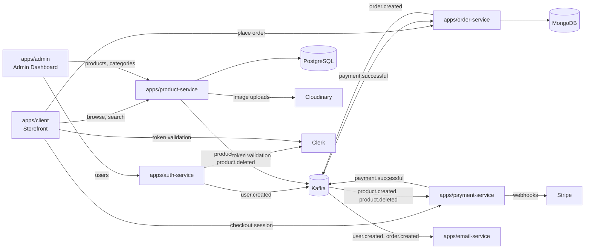

# ShopFlow

An event-driven e-commerce platform built as a **Turborepo** monorepo: a customer storefront, an admin dashboard, and five backend microservices that talk to each other over Kafka.

## Why it's built this way

Most e-commerce demos are a single Next.js app with API routes. This one splits along real service boundaries so that each concern owns its data and its failure modes:

- **Writes stay synchronous, side effects go async.** Placing an order writes to MongoDB and returns. The confirmation email is a Kafka event consumed by a separate worker, so a dead SMTP provider can't fail a checkout.
- **Each service owns its store.** Products live in PostgreSQL (relational: categories, variants, prices). Orders live in MongoDB (document-shaped: a frozen snapshot of line items at purchase time).
- **Shared code is a package, not a copy.** Types, the Kafka client, and both DB clients are workspace packages consumed by every service, so a schema change surfaces as a type error at build time rather than a 500 in production.

## Architecture



### Apps

| App | Stack | Responsibility |
|---|---|---|
| `apps/client` | Next.js 15, Zustand, Stripe Elements | Storefront: browsing, search, cart, checkout |
| `apps/admin` | Next.js 15, TanStack Query + Table | Products, categories, users, orders, analytics |
| `apps/auth-service` | Express, Clerk | User management, admin route protection |
| `apps/product-service` | Express, Prisma, PostgreSQL | Product & category CRUD |
| `apps/order-service` | Fastify, MongoDB | Order creation; marks orders paid on `payment.successful` |
| `apps/payment-service` | Express, Stripe | Checkout sessions, Stripe webhooks, product mirroring |
| `apps/email-service` | Kafka consumer, Nodemailer | Welcome and order-confirmation emails |

### Packages

| Package | Contents |
|---|---|
| `@shopflow/types` | Shared TypeScript types across services |
| `@shopflow/kafka` | Kafka client, producer/consumer wrappers, topic bootstrap |
| `@shopflow/product-db` | Prisma client and PostgreSQL schema |
| `@shopflow/order-db` | MongoDB connection helper |
| `@shopflow/eslint-config` | Shared ESLint config |
| `@shopflow/typescript-config` | Shared `tsconfig` bases |

### Kafka topics

| Topic | Published by | Consumed by |
|---|---|---|
| `user.created` | auth-service | email-service — welcome email |
| `order.created` | order-service | email-service — order confirmation |
| `product.created` | product-service | payment-service — mirrors the product into Stripe |
| `product.deleted` | product-service | payment-service — deactivates the Stripe product |
| `payment.successful` | payment-service | order-service — marks the order paid |

## Requirements

- Node.js >= 18 and `pnpm` 9
- Docker (for Kafka, PostgreSQL, MongoDB)
- Accounts for Clerk (auth), Stripe (payments), Cloudinary (images), and Google OAuth2 (outbound email)

## Setup

```bash
pnpm install
```

Copy every `.env.example` to `.env` in the same directory and fill in the values:

```bash
find . -name '.env.example' -not -path '*/node_modules/*' \
  -exec sh -c 'cp "$1" "$(dirname "$1")/.env"' _ {} \;
```

Start the infrastructure and create the Kafka topics:

```bash
pnpm kafka:up
```

```bash
pnpm kafka:topics
```

Run the PostgreSQL migrations and generate the Prisma client:

```bash
pnpm --filter @shopflow/product-db prisma migrate dev
```

Then start everything:

```bash
pnpm dev
```

## Ports

| Service | URL |
|---|---|
| Storefront | http://localhost:3002 |
| Admin | http://localhost:3003 |
| product-service | http://localhost:8000 |
| order-service | http://localhost:8001 |
| payment-service | http://localhost:8002 |
| auth-service | http://localhost:8003 |

## Configuration notes

- **Cloudinary** uploads use an *unsigned* upload preset. Create one in your Cloudinary dashboard and set `NEXT_PUBLIC_CLOUDINARY_UPLOAD_PRESET` in `apps/admin/.env` (defaults to `shopflow`).
- **Email** sends through Gmail with OAuth2. Set `GOOGLE_MAIL_USER` to the address that owns the OAuth credentials — it is used as the sender.
- **Stripe webhooks** point at `POST /webhooks/stripe` on the payment service. Locally, forward them with `stripe listen --forward-to localhost:8002/webhooks/stripe`.
- `.env` files are gitignored; the `.env.example` files are the source of truth for what each service needs.

## Commands

```bash
pnpm dev            # run every app and service in parallel
pnpm build          # build everything through Turborepo
pnpm check-types    # type-check the whole workspace
pnpm lint           # lint the whole workspace
pnpm format         # prettier across the repo
pnpm kafka:up       # start Kafka in Docker
pnpm kafka:topics   # create the required topics
pnpm docker:up      # start the full stack with docker compose
```

## Deployment

See [`DEPLOY_RAILWAY.md`](./DEPLOY_RAILWAY.md) for deploying the backend services to Railway and the two Next.js apps to Vercel, and [`vercel-envs.txt`](./vercel-envs.txt) for the environment variables each Vercel project expects.
